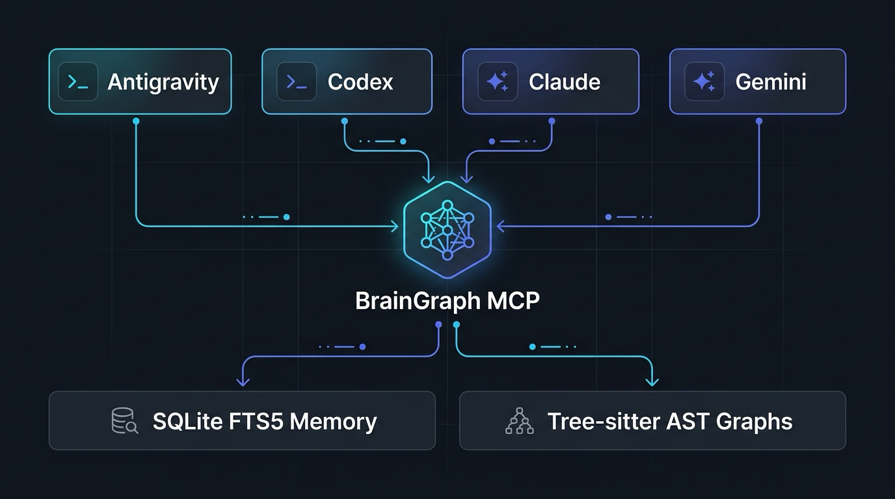
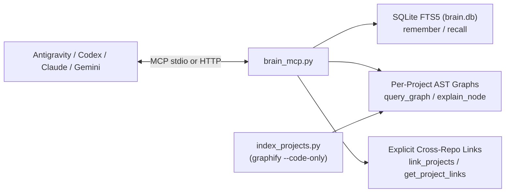

# BrainGraph



[](LICENSE)
[](https://www.python.org/)
[](https://buymeacoffee.com/allanidrajith)

**Zero-cost, local-first persistent memory and AST code-graph MCP server** for **Antigravity**, **Codex**, **Claude Code**, **Cursor**, and **Gemini CLI**.

Stop burning tokens having your AI coding agent re-read and re-grep the same files every new session. BrainGraph pairs **SQLite FTS5 cross-session memory** with **local Tree-sitter AST graphs** (powered by [`graphify`](https://github.com/Graphify-Labs/graphify))—all running locally with **$0 API cost**.

---

## How It Works



### Key Features
- **Zero API / Token Cost:** Built with Python stdlib (`sqlite3` FTS5 + `http.server`) and local `graphify` AST extraction (`--code-only`).
- **Strict Project Isolation:** Each repository gets its own isolated `graph.json` and project-scoped memories (`ABC` never leaks into `DEF`).
- **Explicit Cross-Project Links:** Connect two separate projects with `link_projects` only when they genuinely share an API, protocol, or dependency.
- **Autonomous Agent Rules:** Includes `.agents/rules/braingraph.md` and `SKILL.md` templates so agents automatically `recall` before searching and `remember` decisions after finishing work.
- **Optional Self-Hosted HTTP Mode:** Run `--http` with Bearer token auth (`BRAINGRAPH_TOKEN`) if you want to expose your local brain over a private tunnel (e.g., Tailscale or Cloudflare Tunnel).

---

## Quick Start

### 1. Prerequisites
- Python 3.10+
- [`graphify`](https://github.com/Graphify-Labs/graphify) CLI (for AST code indexing):
  ```bash
  uv tool install graphifyy
  # or: pipx install graphifyy
  ```

### 2. Clone & Test
```bash
git clone https://github.com/allanindrajith/BrainGraph.git
cd BrainGraph
python3 -m unittest discover -s tests -v
```

### 3. Index Your Repositories
Index a single repo or an entire projects folder:
```bash
# Single repository
python3 index_projects.py /path/to/MyApp

# All git repositories inside a workspace directory
python3 index_projects.py --all-in /path/to/projects
```

### 4. Install Skills, Rules & MCP Config
Drop the BrainGraph skill, always-on rule, and `AGENTS.md` snippet into a repository and print the MCP config:
```bash
python3 install_agents.py /path/to/MyApp --print-mcp
```

Add the printed block to your agent's MCP configuration (for Antigravity: `~/.gemini/antigravity/mcp_config.json`):
```json
{
  "mcpServers": {
    "braingraph": {
      "command": "python3",
      "args": [
        "/path/to/BrainGraph/brain_mcp.py"
      ]
    }
  }
}
```

---

## Exposed MCP Tools

| Tool | Purpose |
| :--- | :--- |
| `remember` | Persist a decision, bug root-cause, or note in SQLite FTS5 (`project`-scoped). |
| `recall` | Full-text search across saved memories (optionally filtered by `project`). |
| `list_projects` | List all indexed repositories in BrainGraph. |
| `query_graph` | Search a project's AST `graph.json` for symbols, files, and edges. |
| `explain_node` | Inspect a node and its 1-hop callers/callees/imports. |
| `link_projects` | Record an explicit cross-project edge between two repos. |
| `get_project_links` | List cross-project connections for a given project. |

---

## Optional: Self-Hosted HTTP Mode

```bash
BRAINGRAPH_TOKEN="your-secret-token" python3 brain_mcp.py --http --port 8080
```

- Health check: `GET /health`
- MCP endpoint: `POST /mcp` with `Authorization: Bearer <token>`

---

## Support

If BrainGraph saves you tokens and time, consider supporting the project:

[](https://buymeacoffee.com/allanidrajith)

## License

[MIT](LICENSE)
